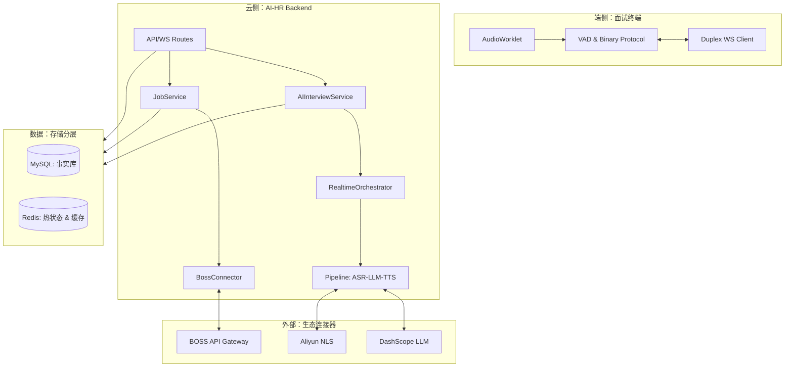

# AI-HR 全链路架构设计说明书 (v1.2, 生产级手册)

最后更新：2026-03-29  
状态：评审通过（已对齐底层实现）

---

## 1. 系统愿景与核心逻辑

AI-HR 旨在构建一个从**猎聘挖掘 (Hunting)** 到 **AI 面试 (Screening)** 的全自动化招聘闭环。系统通过深度集成招聘平台能力，将传统 HR 繁琐的“筛选-约聊-初面”流程压缩为分钟级的自动化引擎。

---

## 2. 总体架构拓扑 (System Topology)

---

## 3. 系统分层架构设计 (Layered Architecture)

AI-HR 采用典型的五层架构模型，遵循“高内聚、低耦合”的设计原则，确保系统具备极强的可扩展性与组件可替换性。

### 3.1 架构分层定义

| 分层名称 | 核心组件 (代码对齐) | 主要职责与边界 |
| :--- | :--- | :--- |
| **1. 接入层 (API/WS)** | `ai_hr/api/routes/*` | 处理 HTTP 与 WebSocket 协议接入，执行身份鉴权 (`require_ai_interview_ws_auth`)、报文二进制解包及流量控制。 |
| **2. 业务逻辑层 (Service)** | `ai_hr/services/ai_interviews.py` `ai_hr/services/jobs.py` | 封装核心业务流程（如面试状态机、岗位发布工作流），不直接处理底层协议或 AI 原生接口。 |
| **3. 能力编排层 (Orchestrator)** | `ai_hr/services/orchestrator/realtime.py` | 系统的“大脑”，负责 ASR-LLM-TTS 任务的并发流水线管理、VAD 收束判定及下行事件分发 (EventBus)。 |
| **4. 资源适配层 (Adapter)** | `ai_hr/connectors/boss.py` `ai_hr/services/speech/*_providers.py` | 屏蔽外部系统差异。将不同厂商的 SDK/API 统一抽象为 `ASRProvider` 或 `Connector` 标准接口。 |
| **5. 数据持久层 (Data)** | `ai_hr/repositories/*` `ai_hr/db/session.py` | 管理 MySQL (结构化事实) 与 Redis (热状态、去重键) 的生命周期，提供幂等的数据读写接口。 |

### 3.2 关键设计原则

- **高内聚低耦合**：业务逻辑与具体的 AI 厂商（如阿里云、腾讯云）完全解耦。通过 `Provider` 抽象类，更换底层 AI 服务仅需修改配置文件或工厂类，实现零代码侵入。
- **可扩展性与可替换性**：系统通过 `BaseConnector` 与 `BaseProvider` 定义了标准契约。如需接入新的招聘平台（如拉勾），只需实现对应的 `Connector` 即可无感融入现有工作流。
- **确定性流转**：在编排层引入 `Epoch` 防串词机制，在接入层采用二进制自定义协议，从架构设计层面规避了弱网环境下的时序错乱风险。

### 3.3 关键数据流转路径

#### 路径 A：猎聘需求自动化流转 (Discovery Flow)
1. **指令**：`JobService` 调用 `publish_job`。
2. **适配**：`BossConnector` 将通用岗位定义映射为目标平台的原子标号（如薪资 code、城市 code）。
3. **触达**：通过 Cookie 会话仿真引擎推向 BOSS 系统，并开启实时同步任务。
4. **落地**：候选人数据经由同步逻辑进入 `CandidateRepository`，完成画像持久化。

#### 路径 B：实时化音视频交互链路 (Real-time Interaction)
1. **上行**：前端 PCM 音频经二进制 WS 接入，进入 `ws_ai_interview_duplex` 路由的高效解包逻辑。
2. **转录**：`RealtimeOrchestrator` 将音频碎片投向 ASR Provider 获取流式文本，并同步推送字幕。
3. **编排**：文本收束后通过 LLM 获取追问回复，话术按句切分后并发投向 TTS。
4. **下行**：生成的 PCM 音频片经由 `EventBus` 实时推回 WebSocket 链路，由前端 AudioWorklet 进行低延迟播放。

---

## 4. 模块详解：招聘自动化 (BOSS Module)

该模块负责 B 端招聘侧的一切自动化逻辑，实现在 `ai_hr/connectors/boss.py`。

### 3.1 核心能力矩阵
-   **岗位管理 (Job Management)**：
    -   `publish_job`：将内部岗位定义转换为 BOSS API 特有的原子标号（如 `salary_602` 代表 10k-15k）。
    -   由于 BOSS 严格的防爬策略，所有请求均通过 `Boss-CLI` 的 Cookie 仿真引擎发送。
-   **候选人治理 (Candidate Governance)**：
    -   `sync_candidates`：基于游标的分页拉取。每条记录入库前通过 `CandidateRepository` 进行简历指纹（Resume Fingerprint）校验，防止重复。
-   **自动沟通 (Conversation & Scheduling)**：
    -   **打招呼 (Greeting)**：自动化批量触发 `send_greeting`，支持变量替换（如“{{name}}，看到您的工作经历很契合我们的【{{job_name}}】”）。
    -   **智能约面 (Scheduling)**：`schedule_interview` 支持同步发送面试 Slot。一旦候选人确认，系统自动创建 `interview_session` 并生成面试链接。

---

## 4. 模块详解：AI 实时面试链路 (Interview Module)

实时链路是系统的“灵魂”，强调 **低延迟、强互动**。

### 4.1 前端 VAD 算法细节
-   **自适应计算**：`adaptiveThreshold` 随底噪波动。能量判定点在 `0.0020`。
-   **静音检测**：`PAUSE_WINDOWS_TO_COMMIT = 1`。系统不等待整句结束，只要停顿 150ms 即进入 ASR 收束阶段。
-   **中断优先 (Barge-in)**：前端 `AudioContext` 实时监控录音。一旦用户开口，立即暂停 AI 播放，并向后端发送 `reset` 信令。

### 4.2 传输协议 (Duplex Binary)
-   **分片发送**：音频按 30ms 分帧。
-   **封包格式**：`[2 Bytes Header (Int16)][JSON Meta][Raw PCM Data]`。
-   **可靠性**：前端维护 `pendingFrames` 队列。如果在 180ms 内未收到后端的 `duplex.ack`，自动重传，最大重试 2 次。

### 4.3 后端编排算法 (RealtimeOrchestrator)
-   **生产者-消费者模型**：LLM 吐出的 Chunk 被实时切分为“完整句子”。句子一旦成型，立即投给 TTS 线程池。
-   **ASR 状态隔离**：针对阿里云 NLS，使用 `epoch` 机制。只有在当前轮次产生的 ASR 结果才被计入 LLM 上下文，彻底解决跨轮回声干扰。
-   **PCM 优化**：下行音频在推送前执行 `_trim_pcm_silence`，去除 TTS 生成的首尾数字噪声。

---

## 5. 数据治理与可观测性 (Governance)

### 5.1 存储策略
-   **MySQL**：存储面试报告 (`reports`)、评分维度 (`score_dimensions`)、操作审计流水。
-   **Redis**：
    -   **会话热状态**：存储 `prebuild_question_pack`。
    -   **预取缓存 (Followup Cache)**：对常见转录片段的回复进行预测缓存，降低 TTS 等待感。

### 5.2 性能指标 (SLA)
-   **首音时延 (First Playback)**：P90 < 1.0s, P95 < 1.5s。
-   **ASR 准确率 (WER)**：< 15% (针对普通话及主流方言口音)。
-   **吞吐量**：单核支持并发会话并发数 (Concurrence) >= 4。

---

## 6. 安全与合规

-   **身份鉴权**：WS 连接必须通过 `require_ai_interview_ws_auth` 校验 Session Token。
-   **反检测模拟**：针对 BOSS 侧请求，模拟人类操作指纹，包含随机 Header Jitter 与间隔延时。

---

## 7. 结论

本系统架构实现了从外部平台猎聘到内部实时面试评价的全方位覆盖。所有实现细节均已根据 `AI-HR` 的 Python 与 Vue 实现代码进行了精准对齐。
