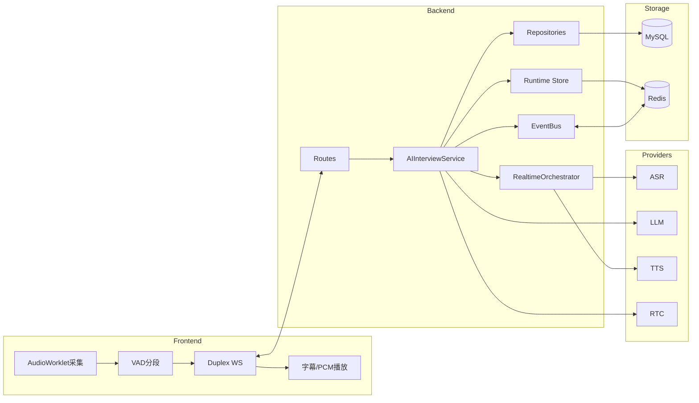
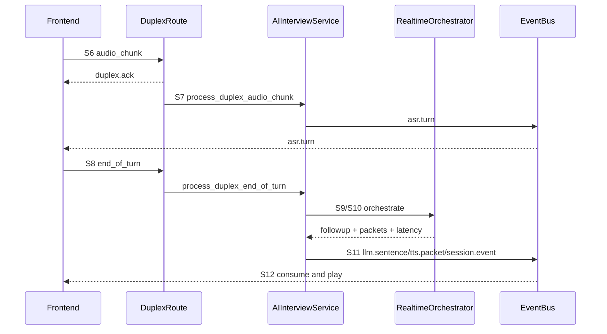
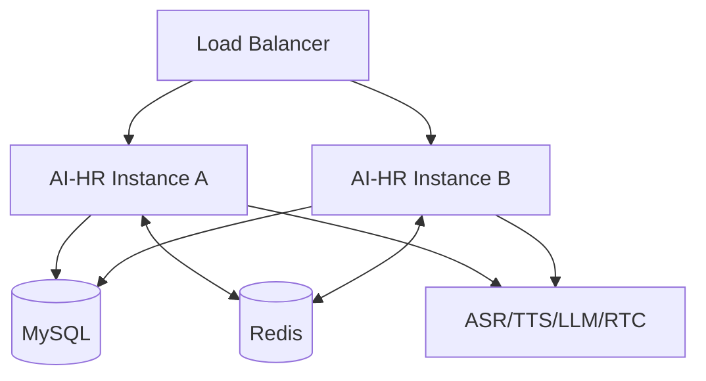

# AI-HR 架构设计与链路说明（v3，评审重构版）

最后更新：2026-03-28  
适用范围：`AI-HR` 后端 + `frontend` 候选人实时面试端

---

## 0. 阅读导航

本文按三层组织，避免“概念、实现、运维”混写：

- A 层（第 1-4 章）：架构与决策，回答“为什么这样设计”。
- B 层（第 5-8 章）：实现与链路，回答“代码如何工作”。
- C 层（第 9-11 章）：治理与运维，回答“如何稳定运行”。

文中统一使用“黄金路径 S1~S12”做跨章节引用，避免重复叙述。

状态标记说明：

- `现状（已实现）`：仓库中已有代码支撑。
- `规划（待实现）`：建议演进项，不代表当前能力。

---

## 1. 设计目标与边界（A 层）

### 1.1 设计目标

AI-HR 实时面试链路目标分三类：

1. 体验目标：候选人停顿后快速得到可听追问。
2. 稳定目标：面对重复包、超时、抖动链路可继续。
3. 治理目标：每轮对话可追溯、可审计、可度量。

### 1.2 系统边界

- 前端负责：采集、VAD、上行可靠性、播放与打断。
- 后端负责：会话状态机、编排决策、持久化与事件分发。
- Provider 负责：ASR/TTS/LLM/RTC 能力，不承载业务状态。

### 1.3 非目标

- 不在本文覆盖 UI 视觉设计。
- 不在本文展开第三方厂商内部实现。
- 不在本文讨论企业级 BI 建模。

---

## 2. 架构决策总览（A 层）

### 2.1 关键决策

1. 双通道决策：主链路 Duplex WS，回退链路 REST。
2. 分层决策：`Route -> Service -> Orchestrator -> Provider -> Repository`。
3. 状态决策：热状态（Redis/Memory）与事实状态（MySQL）分离。
4. 韧性决策：幂等、去重、背压、降级作为设计内能力。

### 2.2 决策收益

- 低延迟：减少整句串行等待。
- 高可用：主链路失败时有可运行兜底路径。
- 可演进：Provider 可替换，业务层不被 SDK 污染。
- 可治理：时延可分段，事件可复盘。

### 2.3 决策代价

- 实时链路任务编排复杂度高。
- 参数面增大，需要统一治理。
- 多层去重和回退需要更严格测试基线。

---

## 3. 逻辑架构图与代码映射（A 层）

代码锚点：

- 入口：`ai_hr/main.py`
- 路由：`ai_hr/api/routes/ai_interviews.py`
- 服务：`ai_hr/services/ai_interviews.py`
- 编排：`ai_hr/services/orchestrator/realtime.py`
- 总线：`ai_hr/services/orchestrator/event_bus*.py`
- 运行时存储：`ai_hr/services/interview_runtime/*`
- 前端：`frontend/src/App.vue`、`frontend/src/api.ts`

---

## 4. 黄金路径定义（A 层）

为避免跨章重复叙述，定义统一主流程编号：

- S1：前端获取/创建 session。
- S2：建立 `events/ws`。
- S3：建立 `rtc/duplex/ws`。
- S4：后端 warmup ASR/TTS。
- S5：前端采集 PCM 并做 VAD 分段。
- S6：发送 `audio_chunk`，等待 ACK。
- S7：后端队列消费分片，输出 ASR partial/final。
- S8：前端发送 `end_of_turn`。
- S9：后端 `append_event` 触发编排。
- S10：编排器执行 ASR/决策/LLM/TTS。
- S11：事件总线回推字幕、追问、音频包。
- S12：前端实时播放与打断控制。

以下 B/C 层章节均以该编号引用。

---

## 5. 端到端主链路（Duplex）实现说明（B 层）

### 5.1 目标

覆盖 S1~S12，形成“边采边传边回推”闭环，优先满足低延迟交互。

### 5.2 现状（已实现）

- S1-S4：会话初始化与双连接建立后，后端执行 `asr_warmup/tts_warmup`。
- S5-S6：前端 16k PCM + VAD，30ms 分帧上行，附 `frame_id/seq/chunk_index`。
- S7：后端先 ACK 再处理；`audio_chunk_queue` 串行消费，避免并发污染。
- S8-S10：EOT 触发轮次收束，进入 `RealtimeOrchestrator`。
- S11-S12：并行下发 `asr.turn / llm.sentence / tts.packet + binary pcm`，前端即时播放并可打断。

### 5.3 关键协议点

上行关键字段：

- `frame_id`：帧去重主键。
- `seq`：轮次主键。
- `chunk_index/chunk_total/is_final`：分片信息。

下行关键事件：

- `duplex.ack`：接收确认。
- `duplex.error`：协议/容量异常。
- `duplex.llm.sentence`：追问句流。
- `duplex.tts.packet` + binary：播报分包。

### 5.4 关键时序图

### 5.5 风险与边界

- 复杂度集中在 duplex route 任务协作。
- 参数分散（VAD、队列、超时）带来调优成本。
- 需要严格压测验证队列上限和重传策略。

---

## 6. 回退链路（REST）实现说明（B 层）

### 6.1 目标

在 Duplex 不可用时，保证会话流程不断。

### 6.2 现状（已实现）

1. 调用 `/rtc/asr/stream` 获取整句 transcript。
2. 调用 `/sessions/{id}/events` 触发追问。
3. 调用 `/rtc/tts/stream` 获取音频 URI 并播放。

### 6.3 适用场景

- WS 连接不稳定。
- 服务端关闭 duplex 开关。
- 前端临时兼容环境不支持稳定 binary 路径。

### 6.4 代价

- 串行链路长，时延显著高于 Duplex。
- 对“实时连续对话”体验支持较弱。

---

## 7. 状态一致性与可靠性机制（B 层）

### 7.1 目标

确保“每一轮只处理一次、每条事件可追溯、过载可控”。

### 7.2 现状（已实现）

多层去重：

- Frame 级：`frame_id` 滑窗去重。
- Event 级：`event_id` 幂等去重。
- Turn 级：`seq` final 防重复触发。

背压与容量：

- 队列满返回 `server_busy`。
- ACK 与处理解耦，避免接收主循环阻塞。

降级机制：

- `llm_to_rule`
- `tts_to_text_only`
- 组合降级

### 7.3 风险与边界

- 多层去重逻辑需要保持统一口径，避免“误去重”或“漏去重”。
- 过高重试策略会反向放大压力。

---

## 8. 数据与 Provider 运行时实现（B 层）

### 8.1 数据分层

事实层（MySQL）：会话、turn、题集、报告、trace、decision log。  
热状态层（Redis/Memory）：question pack、session flow state、dedup key、followup cache。

### 8.2 Provider 抽象

- RTC：`mock/livekit`
- ASR：`mock/openai/tencent/aliyun/aliyun_nls`
- TTS：`mock/openai/tencent`
- LLM：runtime 配置优先，环境配置兜底

### 8.3 生产保护

`ModelRouter` 在生产环境禁止 mock 路由落地，避免“误配置上线”。

---

## 9. 可观测性与 SLA（C 层）

### 9.1 目标

把“慢/不稳”拆解成可定位、可告警、可回归的指标。

### 9.2 现状（已实现）

- 会话处理面：accepted/duplicate/drop
- 时延面：asr/llm/tts/e2e
- 治理面：handoff/blocked/latency p95
- 健康面：`/health`、`/health/providers`

### 9.3 建议 SLA（规划）

- ACK p95 <= 80ms
- ASR final p95 <= 900ms
- LLM 首句 p95 <= 1000ms
- TTS 首包 p95 <= 500ms
- 首次可听 e2e p95 <= 2200ms

---

## 10. 安全、审计与合规（C 层）

### 10.1 现状（已实现）

- HTTP/WS 鉴权：`x-api-key` 或 Bearer。
- 生产强制鉴权。
- LiveKit webhook JWT HS256 验签。
- 关键动作审计事件入库。

### 10.2 风险控制点

- 密钥配置为空时强制失败而非放行。
- WS 鉴权失败主动 close，降低滥用资源风险。

---

## 11. 部署、扩展与演进路线（C 层）

### 11.1 现状部署模型

- 单实例：In-Process EventBus + Memory Runtime Store。
- 多实例：Redis EventBus + Redis Runtime Store（推荐生产）。

### 11.2 演进路线（规划）

P0

1. 统一链路 trace_id。
2. 收敛 duplex 协议版本定义。
3. 参数治理表（VAD/ACK/队列/超时）集中化。

P1

1. 抽离 duplex route 内部编排为独立模块。
2. 建立故障注入测试（ASR 慢、LLM 超时、TTS 失败、Redis 断连）。
3. 建立发布门禁（SLO 不达标不放行）。

P2

1. 动态模型路由（成本/质量/时延策略）。
2. followup 质量离线评测闭环。
3. 容量模型固化（每核承载会话数）。

---

## 12. 附录（下沉细节）

### 12.1 接口契约附录（建议后续补齐）

- REST：`/sessions/*`、`/rtc/asr/stream`、`/rtc/tts/stream`
- WS：`events/ws`、`rtc/duplex/ws`、`rtc/asr/ingest/ws`

建议字段：入参、出参、错误码、幂等键、重试语义。

### 12.2 时延预算附录（建议后续补齐）

- 预算项：采集/VAD、上行传输、ASR、LLM、TTS、播放启动。
- 输出：预算值、告警阈值、回归基线。

### 12.3 故障手册附录（建议后续补齐）

建议模板：

- 症状
- 关键指标
- 排查步骤
- 临时缓解
- 回滚开关

---

## 13. 结论

该版本将文档从“信息堆叠”重构为“分层叙事 + 统一主线 + 现状/规划分离”的评审形态。  
对研发而言，它可对照代码实现；对评审而言，它可验证设计决策；对运维而言，它可落到稳定性与SLA治理。
