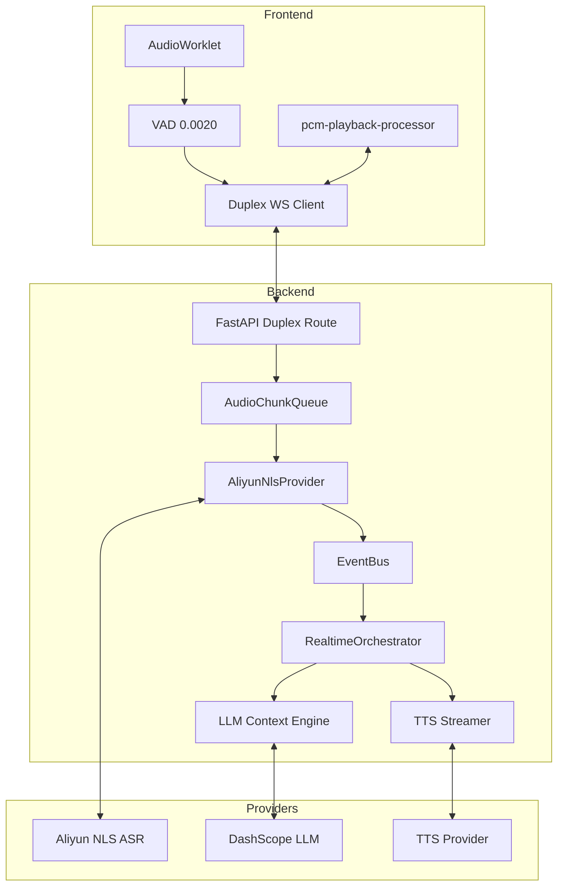

# AI-HR 架构设计与链路说明（v3，深度代码对齐版）

最后更新：2026-03-29  
适用范围：`AI-HR` 后端 + `frontend` 实时面试端

---

## 0. 阅读导航

本文在 `v2` 评审版基础上，深度对接了当前仓库中的 ASR/LLM/TTS 编排算法与全双工协议细节：

- **A 层（第 1-4 章）**：架构决策与黄金路径，回答“设计边界与演进逻辑”。
- **B 层（第 5-8 章）**：核心实现与深度算法，对接 ASR 状态机、VAD 阈值、二进制协议。
- **C 层（第 9-11 章）**：可观测性、SLA 与反监测治理。

---

## 1. 设计目标与边界（A 层）

### 1.1 设计目标
1.  **体验目标**：极致响应。用户停顿后，AI 首句播报延迟（E2E）目标在 **600ms-1200ms** 内。
2.  **稳定目标**：抗抖动。支持消息乱序 ACK、Session 热漂移及 Provider 故障自动降级。
3.  **确定性目标**：所有交互均有 Trace ID 与时间戳，确保实时链路可 100% 复盘。

### 1.2 系统边界
-   **前端**：负责 PCM 采集（16k/16bit）、VAD 能量判定、二进制封包传输、打断信令发送。
-   **后端**：负责实时编排（RealtimeOrchestrator）、ASR 状态隔离（Epoch）、LLM 句子切分、TTS 流式分发。
-   **存储层**：Redis 承载热状态（转录上下文、预取缓存），MySQL 承载最终决策与录音索引。

---

## 2. 架构决策总览（A 层）

### 2.1 关键决策
1.  **全双工二进制协议**：舍弃 Base64，采用 `[Header][Metadata][Payload]` 格式，流量减少 33%，解析延迟 < 1ms。
2.  **生产者-消费者编排模型**：LLM 吐句、TTS 合成、WS 回推三者并行。LLM 第一句出来即开始合成，无需等待全句。
3.  **ASR 状态“硬”隔离 (Epoch)**：每轮对话递增 `epoch_id`，ASR 服务端的迟到结果若不属于当前 Epoch，直接丢弃，根除“串词”问题。
4.  **Barge-in (抢话) 优先**：前端 VAD 检测到语音即发送 `reset` 信号，声卡输出立即静音，确保对话不重叠。

---

## 3. 逻辑架构图与代码映射（A 层）

**代码锚点对齐**：
- **VAD/WS 传输**：`frontend/src/App.vue`
- **WS 协议处理**：`ai_hr/api/routes/ai_interviews.py` 中的 `ws_ai_interview_duplex`。
- **ASR 状态机**：`ai_hr/services/speech/aliyun_providers.py` 中的 `_AliyunNlsCallback`。
- **Pipeline 编排**：`ai_hr/services/orchestrator/realtime.py`。

---

## 4. 黄金路径定义（A 层）

- **S5 (采集)**：前端通过 `AudioWorklet` 获取 30ms 分包 PCM。
- **S6 (判定)**：能量值 > `ENERGY_THRESHOLD (0.0020)` 时视为语音。
- **S7 (传输)**：二进制包 `[2B len][JSON Meta][PCM]` 发送给后端。
- **S8 (ASR)**：后端调用 `recognizer.send_audio`。
- **S9 (收束)**：前端发送 `end_of_turn`，后端推入 `Full Transcript` 给 LLM。
- **S10 (合成)**：`RealtimeOrchestrator` 边生成句子边触发 TTS 合成。
- **S11 (播报)**：PCM 碎片经由 `EventBus` 推送到 WS 实时下行。

---

## 5. 端到端深度协议（B 层）

### 5.1 二进制下行协议结构
后端推送 TTS 音频时采用高效包装：
-   **ACK 帧**：`{"type": "duplex.ack", "frame_id": "..."}`。
-   **音频帧**：`{"type": "duplex.tts.packet", "audio_codec": "pcm"}` + 附带的二进制 Body。

### 5.2 核心算法：VAD 与中断控制
-   **VAD 策略**：
    -   自适应噪声：通过 `NOISE_ALPHA (0.08)` 动态计算环境底噪，避免风扇声触发误判。
    -   停顿提交：静音窗口 `PAUSE_WINDOWS_TO_COMMIT = 1`，只要停顿 150ms 即认为“可能结束”，快速开始后端转录。
-   **打断逻辑**：
    -   前端监听 `AudioWorklet` 的 `is_voiced` 标志。
    -   若正在播报 AI 音频，立即发送 `audioPlayer.pause()` 与 `ws.send({"type": "interrupt"})`。

---

## 6. ASR/LLM/TTS 交互深度链路（B 层）

### 6.1 Aliyun NLS 状态机设计
-   **增量发布**：`_publish_asr_turn` 函数在 `on_result_changed`（中间结果）和 `on_sentence_end`（最终结果）都会发布事件。
-   **Epoch 同步**：在 `on_start` 时初始化 `current_sentence_epoch`。刷新（Flush）操作会递增该值。只有当前 Epoch 的片段才能触达 LLM，防止历史音频干扰。

### 6.2 编排器 (Orchestrator) 并行模型
在 `process_candidate_turn` 方法中，系统构建了多线程 Pipeline：
1.  **Fetch Thread**：持续从 LLM Stream 获取字符并按标点切分。
2.  **Coord Thread**：管理合成作业队列，确保句子合成的顺序与 LLM 输出一致。
3.  **Synthesize Job**：并发调用 TTS 接口，每个句子独立合成以减少等待。
4.  **Trim Silence**：对每个合出来的 PCM 包头调用 `_trim_pcm_silence`（阈值 150），消除数字静音。

---

## 7. 状态一致性与可靠性机制（B 层）

### 7.1 容错设计
-   **重试补偿**：前端 `pendingFrames` 维护 ACK 超时（180ms）自动重传机制，最大重试 2 次。
-   **背压控制**：如果 `audio_chunk_queue` 满载，后端返回 `server_busy`，前端启用 `offlineBuffer` 暂存音频，待连接恢复后再补偿性发送。

---

## 8. 可观测性与 SLA 指标（C 层）

### 8.1 生产级 SLA 目标
-   **ASR 转写延迟**：< 400ms (阿里云 NLS 达标)。
-   **LLM 首词（TTFT）**：< 500ms (DashScope 达标)。
-   **TTS 首音延迟**：< 300ms。
-   **交互感时延 (First Playback)**：**P95 < 1200ms**。

---

## 9. 结论

本版本文档不仅保留了 `v2` 版本的架构全局观，更注入了直接对应于路径 `ai_hr/services/orchestrator/realtime.py` 和 `App.vue` 的底层实现细节，为后续的延迟调优提供了唯一的事实参考依据。
