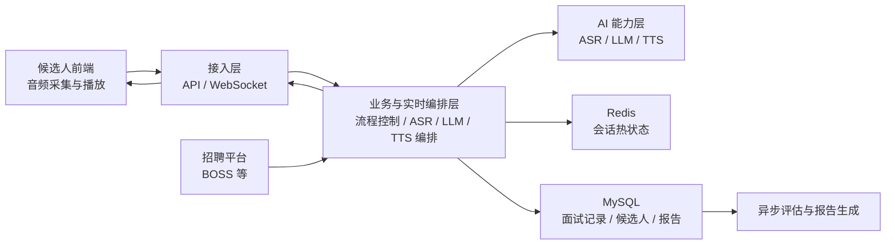

# AI-HR 架构速览

最后更新：2026-03-30

## 项目介绍

AI-HR 是一个把招聘自动化和 AI 面试打通的系统。它一端连接招聘平台，完成岗位发布、候选人同步和消息互动；另一端连接 AI 能力，完成实时语音面试、追问生成和面后评估。我们的目标不是单点做一个 AI 功能，而是把招聘流程里高频、重复、标准化的环节串成一条可持续运行的业务链路。

## 架构说明一：整体分层

整个系统可以理解为四层。最上层是接入层，负责 API 和 WebSocket 接入，承载页面请求、实时音频上行和结果下行；中间是业务层，负责招聘流程和面试流程的状态管理；再往下是 AI 编排层，把 ASR、LLM、TTS 组织成一条实时流水线；最底层是数据与外部能力层，一边对接招聘平台和模型厂商，一边用 Redis 和 MySQL 分别承接热状态与业务事实数据。这样拆分的目的，是把实时交互、业务逻辑、外部依赖和数据存储分开，保证系统既能快速响应，也方便后续扩展。

## 架构说明二：核心链路

AI 面试的核心链路是一个**实时闭环**，设计目标不是把 ASR、LLM、TTS 简单串联起来，而是同时解决 **低时延、不断层、不串话** 三个问题。整条链路从前端采集开始：浏览器持续采集候选人语音，并在本地先做基础检测；音频通过 WebSocket 实时送到后端后，系统先完成语音识别，再由编排器结合题目、上下文和轮次状态触发大模型生成回复；模型一旦产出可播报的句子，就立即进入 TTS 合成，并持续下发到前端播放。核心思路是把“采集、识别、生成、播报”做成一条**流式流水线**，而不是等整轮结束后再一次性返回。

前端侧的重点是 **轻处理、早判断**。前端负责持续采集 PCM 音频，并通过本地的 **VAD、能量阈值和静音窗口** 判断用户当前是否仍在说话；一旦检测到明显停顿，就尽快向后端发出“这一轮可能结束”的信号。这样设计的价值有两点：一是减轻浏览器主线程压力，保证采集和播放稳定；二是把“候选人可能已经讲完”的判断尽早前移，帮助后端更快进入下一步处理。也就是说，前端不做复杂决策，但它负责尽早发现**可以切换轮次的时机**。

ASR 的重点是 **实时转写 + 收束确认**。系统不会等整段音频结束后再一次性识别，而是把音频按流持续送入 ASR，持续接收 **中间转写结果** 和 **最终转写结果**。其中，中间结果主要用于字幕展示和上下文预热，最终结果才作为后续决策的正式输入。这样设计的关键在于，实时语音场景里影响体验的，不只是识别速度，还有系统何时能够确认“这一轮回答真的结束了”。因此，系统会把前端停顿检测和后端 ASR 收束结合起来做二次确认，避免因为短暂停顿、换气或噪声而过早打断候选人。

LLM 的重点是 **基于上下文的流式生成**。编排器不会把大模型当成单轮问答工具，而是把它放在完整的面试上下文中：包括当前题目、上一轮回答、当前阶段、已有追问和当前轮次状态。模型输出也不是等全文生成后再处理，而是按句流式产出，系统一旦拿到**可播报句子**，就立即推进到下游。这样做一方面可以缩短首句时延，让 AI 更快开口；另一方面也能保证追问紧贴当前语境，而不是生成脱离上下文的通用回答。换句话说，LLM 负责决定这一轮**该说什么、怎么追问、如何延续对话**。

TTS 的重点是 **句子级合成 + 实时回推**。系统不会等 LLM 全部输出完再整段合成，而是把已经成型的句子立刻送入 TTS，边合成边把音频包回推给前端。这样前端在后续内容尚未全部准备好的情况下，也能先播放前面的句子，显著减少用户感知到的停顿。与此同时，TTS 还需要兼顾播放连续性，避免因为切分过细而造成断续和生硬。因此，它的核心不是一味追求最小分片，而是在**尽快发出第一句**和**保持整段播报自然**之间取得平衡。

## 架构说明三：关键设计思路

这套架构最关键的设计点有三个。第一，实时链路和异步链路分开，面试当下只保证对话体验，评分和报告放到异步任务执行，避免拖慢主链路。第二，系统通过统一的 Provider 和 Connector 适配层隔离外部平台与模型差异，这样无论是切换招聘平台，还是更换 ASR、LLM、TTS 厂商，都不会影响上层业务逻辑。第三，运行时状态放在 Redis，业务事实落在 MySQL，这样既能支撑实时会话中的高频读写，也能保证面试记录、评估结果和流程事件可追溯、可复盘。

## 流程图

## 总结话术

如果一句话概括，AI-HR 做的事情就是把“招聘平台自动化”和“AI 实时面试”放到同一套架构里：前面用平台连接器打通岗位和候选人，过程里用实时编排把 ASR、LLM、TTS 串成低时延对话，后面再把数据沉淀成可评估、可追溯的报告。这样系统既能提升招聘效率，也能保证整条链路是可扩展、可替换、可持续演进的。
