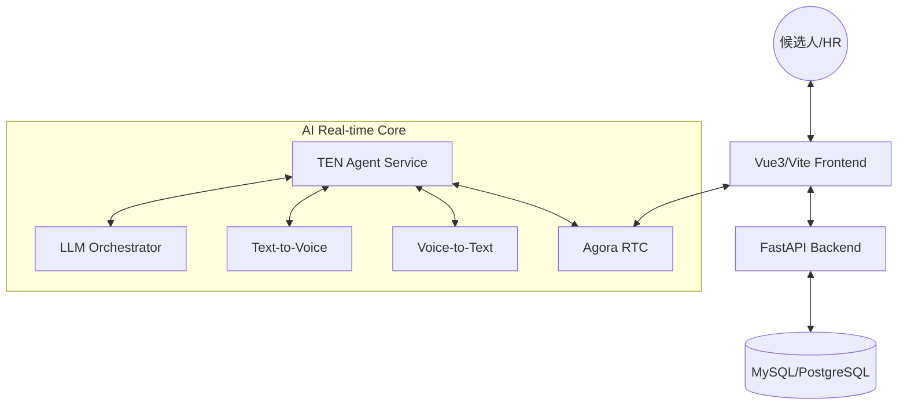

 AI-HR: 智能招聘自动化平台 (AI-Driven Recruitment Platform)

<p align="center">
  
  
  
  
</p>

AI-HR 是一套专为企业设计的**端到端智能招聘自动化解决方案**。它通过大型语言模型 (LLM) 与实时通信技术 (RTC) 的深度融合，实现了从职位发布到“无人值守”面试的全流程自动化。

[English](./README_EN.md) | 简体中文

---

## 📽️ 核心演示

> [!TIP]
> 此处建议放置 10-15 秒的项目演示 GIF 或短视频，展示实时语音面试的低延迟交互体验。

---

## 🔥 为什么选择 AI-HR?

| 特性 | 传统 AI 招聘工具 | AI-HR |
| :--- | :--- | :--- |
| **交互方式** | 文字/异步录播 | **实时语音/视频对谈** |
| **响应速度** | 5s - 10s (高延迟) | **< 1s (低延迟、拟人化)** |
| **评估深度** | 关键词匹配 | **基于语义的深度技术追问** |
| **自动化程度** | 仅筛选简历 | **简历 -> 邀约 -> 面试 -> 报告全自动** |

---

## 🏗️ 系统架构



---

## 🌟 核心特性

- **自动化职位同步**: 自动同步主流招聘平台（如 Boss 直聘）的职位状态与应聘者信息。
- **AI 简历深度解析**: 不再局限于关键词匹配，基于语义理解对简历进行多维度打分，精准识别候选人优势。
- **实时 AI 语音面试**: 结合 [TEN Framework](https://github.com/ten-framework) 与 RTC 技术，实现低延迟、拟人化的实时语音面试。
- **多模态交互引擎**: 集成 ASR (语音转文字)、TTS (文字转语音) 与 LLM，支持面试过程中的智能追问与技术细节核实。
- **全自动招聘流转**: 根据 AI 评估得分，自动触发简历状态变更（通过筛选、发起邀约、生成报告）。
- **企业级可观测性**: 内置熔断器 (Circuit Breaker)、幂等处理与请求监控，确保在大规模并发场景下的稳定性。

---

## 🏗 系统架构

系统由以下核心模块构成：

- **`ai_hr.api`**: 基于 FastAPI 的 RESTful 接口层，提供候选人管理、职位同步等 API。
- **`ai_hr.services`**: 核心业务逻辑层，包含 AI 简历评分、面试编排器 (Orchestrator) 与数据同步。
- **`ten_agent`**: 实时交互体，负责处理面试过程中的音视频流、静音检测 (VAD) 及语义中断。
- **`ai_hr.db`**: 基于 SQLAlchemy 的持久化层，支持 MySQL/PostgreSQL。

---

---

## 🛠️ 环境要求与安装

### 1. 环境依赖
- **Python**: 3.10+ (后端), **3.11** (推荐用于 TEN Agent)。
- **Node.js**: v18.x 或更高版本 (用于前端)。
- **操作系统**: 
  - 后端/前端: Windows 或 Linux。
  - **TEN Agent: 必须在 WSL (Windows Subsystem for Linux) 或原生 Linux 环境下运行**。
- **包管理工具**: 
  - 后端推荐使用 [uv](https://github.com/astral-sh/uv)。
  - 前端使用 `npm` 或 `pnpm`。
- **数据库**: MySQL 8.0+ 或 PostgreSQL。

### 2. 安装步骤

#### 后端 (Backend)
项目使用 `pyproject.toml` 管理依赖。
```bash
cd AI-HR

# 推荐：使用 uv 安装 (自动处理虚拟环境与依赖)
uv sync

# 备选：使用 pip 安装
python -m venv .venv
source .venv/bin/activate  # Windows: .venv\Scripts\activate
pip install .
```

#### TEN Agent
Agent 的依赖由插件系统动态管理。
```bash
cd ten_agent
# 部署并链接插件依赖
tman install
```

#### 前端 (Frontend)
```bash
cd frontend
npm install
```

---

## 🔌 第三方服务申请指南

为了使系统全功能运行，你需要准备以下第三方平台的账号与 API Key：

### 1. 核心大模型 (LLM)
- **OpenAI**: 提供简历筛选与面试逻辑编排（推荐 GPT-4o 或 GPT-4o-mini）。
- **DeepSeek / Moonshot**: 作为国产大模型备选，通过 `AI_HR_LLM_BASE_URL` 适配。

### 2. 实时通信 (RTC)
- **声网 (Agora)**: 
  - 注册并创建项目，获取 `App ID` 和 `App Certificate`。
  - 这是实现面试音视频通话的关键。

### 3. 语音能力 (ASR & TTS)
- **腾讯云 (Tencent Cloud)**: 
  - 申请 `SecretId`, `SecretKey`。
  - 开启“语音识别 ASR”和“语音合成 TTS”服务。
- **阿里云 (Aliyun)**: 
  - 获取 `AccessKey ID`, `AccessKey Secret`。
  - 创建智能语音交互项目获取 `AppKey`。

### 4. 对象存储 (Storage)
- **Minio** (本地开发推荐) 或 **AWS S3**: 用于存储候选人上传的简历附件。

---

## 🚀 系统启动流程

请按照以下顺序启动系统组件：

### 第一步：后端服务 (Backend)
后端负责 API 提供、业务逻辑与任务调度。
```bash
cd AI-HR
# 确保已配置 infra/env/.env.system 或 infra/env/.env.secrets
uv run python -m ai_hr.main
```
*   API 文档地址: `http://localhost:8000/docs`

### 第二步：TEN Agent (实时交互智能体)
> [!IMPORTANT]
> 由于 TEN Runtime 依赖 Linux 动态链接库 (.so)，**必须在 WSL 或 Linux 下运行**。

```bash
# 1. 打开 WSL 终端并进入 Agent 目录
cd runtime/ten_agent

# 2. 部署与安装 (tman 方式)
# 这会解析 manifest.json 并安装所有插件依赖
tman install

# 3. 启动 Agent
tman run start

# 启动示例 (带特定会话配置):
tman run start -- --property .ten_sessions/<session_id>.property.json
```

> [!NOTE]
> `--property` 参数用于指定面试会话的动态配置，这些文件通常由后端 Orchestrator 自动生成并存放在 `.ten_sessions` 目录下。


### 第三步：前端界面 (Frontend)
前端提供 HR 管理后台以及候选人面试房间。
```bash
cd frontend
# 安装依赖
npm install
# 启动开发服务器
npm run dev
```
*   访问地址: `http://localhost:5173`

---

---

## ⚙️ 详细配置项说明

项目采用环境变量驱动配置。你可以创建 `infra/env/.env.system` 和 `infra/env/.env.secrets` 文件。所有配置项前缀均为 `AI_HR_`。

### 核心基础配置
| 变量名 | 默认值 | 说明 |
| :--- | :--- | :--- |
| `AI_HR_DATABASE_URL` | `mysql+pymysql://...` | 数据库连接字符串 |
| `AI_HR_LLM_PROVIDER` | `mock` | LLM 提供商 (`openai`, `deepseek`, `mock`) |
| `AI_HR_LLM_API_KEY` | - | LLM API Key |

### 实时面试配置 (TEN & RTC)
| 变量名 | 默认值 | 说明 |
| :--- | :--- | :--- |
| `AI_HR_RTC_PROVIDER` | `mock` | 实时音视频提供商 (`agora`) |
| `AI_HR_AGORA_APP_ID` | - | 声网 App ID |
| `AI_HR_AGORA_APP_CERTIFICATE` | - | 声网 App Certificate |
| `AI_HR_AI_INTERVIEW_TEN_ENABLED` | `false` | 是否开启 TEN 智能体模式 |

### 语音能力配置 (ASR/TTS)
| 变量名 | 默认值 | 说明 |
| :--- | :--- | :--- |
| `AI_HR_ASR_PROVIDER` | `mock` | `aliyun`, `tencent` 或 `mock` |
| `AI_HR_TTS_PROVIDER` | `mock` | `aliyun`, `tencent` 或 `mock` |

---

## 📝 开发规范

## 📝 开发规范

- **类型检查**: 项目强制使用类型注解，运行 `mypy` 进行静态检查。
- **代码格式**: 使用 `ruff` 或 `black` 进行格式化。
- **测试**: 单元测试位于 `tests/` 目录下，使用 `pytest` 运行。

---

## ⚠️ 注意事项

- **凭据安全**: 请勿将 `infra/env/.env.secrets` 提交至版本控制系统。
- **Provider 熔断**: 当第三方 AI 接口连续失败达到阈值时，系统会触发熔断保护，可通过 `AI_HR_PROVIDER_CIRCUIT_BREAKER_FAIL_THRESHOLD` 调整。

---

## 🗺️ 路线图 (Roadmap)

- [x] 基于 TEN Framework 的实时语音面试
- [x] 多维度简历 AI 评估系统
- [x] 自动对接 Boss 直聘职位同步
- [ ] **Next:** 视频面部表情与情绪分析
- [ ] **Next:** 支持更多面试语种 (日语/韩语/英语)
- [ ] **Next:** 移动端小程序适配
- [ ] **Next:** 离线私有化模型部署方案

---

## 🤝 参与贡献

我们欢迎所有形式的贡献！无论是提交 Bug、改进文档还是贡献核心代码。

1. Fork 本仓库
2. 创建特性分支 (`git checkout -b feature/AmazingFeature`)
3. 提交更改 (`git commit -m 'Add some AmazingFeature'`)
4. 推送到分支 (`git push origin feature/AmazingFeature`)
5. 开启 Pull Request

---

## 📄 开源协议

本项目基于 [Apache-2.0](./LICENSE) 协议开源。

---

© 2026 AI-HR Team. Built with Passion & Intelligence.