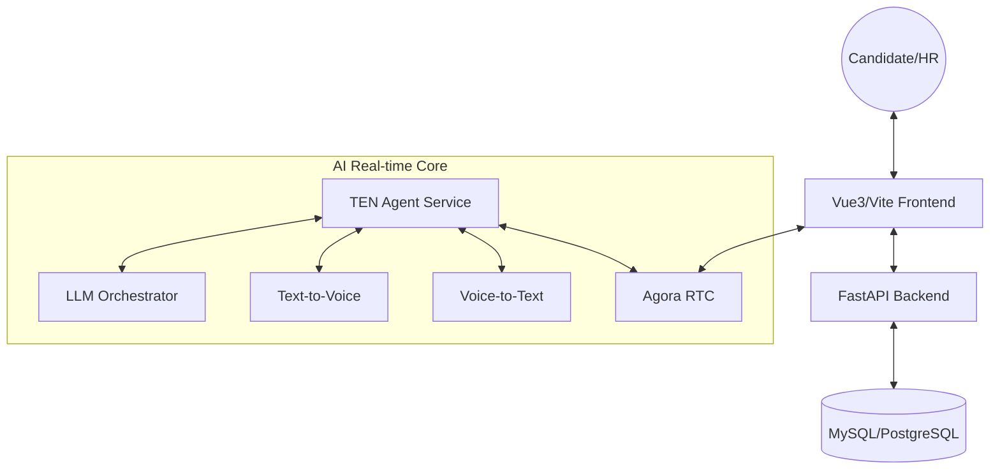

# AI-HR: Intelligent Recruitment Automation Platform

<p align="center">
  
  
  
  
</p>

AI-HR is an **end-to-end intelligent recruitment automation solution** designed for modern enterprises. By deeply integrating Large Language Models (LLMs) with Real-Time Communication (RTC) technologies, it achieves a fully automated recruitment workflow from job posting to "unattended" interviews.

English | [简体中文](./README.md)

---

## 🌟 Key Features

- **Automated Sourcing & Sync**: Seamlessly sync jobs and applicant data from mainstream recruitment platforms (e.g., Boss Zhipin).
- **Deep AI Resume Analysis**: Beyond keyword matching, it leverages semantic understanding to score candidates across multiple dimensions.
- **Real-time AI Voice Interviews**: Powered by [TEN Framework](https://github.com/ten-framework) and RTC, providing low-latency, human-like voice interview experiences.
- **Multimodal Interaction Engine**: Integrated ASR, TTS, and LLMs to support intelligent technical follow-up questions.
- **Automated Workflow**: Automatically triggers recruitment status changes based on AI evaluation scores.
- **Enterprise-grade Observability**: Built-in Circuit Breakers, Idempotency, and comprehensive request monitoring.

---

## 🔥 Why AI-HR?

| Feature | Traditional AI Tools | AI-HR |
| :--- | :--- | :--- |
| **Interaction** | Text / Async Recording | **Real-time Voice/Video** |
| **Response Latency** | 5s - 10s (High) | **< 1s (Low-latency)** |
| **Evaluation Depth** | Keyword matching | **Deep Semantic Technical Probing** |
| **Automation** | Resume screening only | **Full Lifecycle: Resume -> Invite -> Interview -> Report** |

---

## 🏗️ System Architecture



---

## 🛠️ Environment & Installation

### 1. Prerequisites
- **Python**: 3.10+ (Backend), **3.11** (Recommended for TEN Agent).
- **Node.js**: v18.x or higher (for Frontend).
- **OS**: 
  - Backend/Frontend: Windows or Linux.
  - **TEN Agent: Must run in WSL (Windows Subsystem for Linux) or Native Linux**.
- **Database**: MySQL 8.0+ or PostgreSQL.

### 2. Installation Steps

#### Backend
```bash
cd apps/backend
# Recommended: install via uv
uv sync
# Alternative: install via pip
pip install .
```

#### TEN Agent
```bash
cd runtime/ten_agent
# Install dependencies via TEN Manager
tman install
```

#### Frontend
```bash
cd apps/frontend
npm install
```

---

## 🔌 Third-party Service Guide

To enable full functionality, you need to prepare the following:

- **LLM**: OpenAI (GPT-4o recommended) or other providers.
- **RTC (Agora)**: Register and get `App ID` and `App Certificate`.
- **Speech (ASR & TTS)**: Tencent Cloud or Aliyun credentials.
- **Storage**: Minio (local) or AWS S3 for resume attachments.

---

## 🚀 Startup Flow

### Step 1: Backend Service
```bash
cd apps/backend
# Prepare env files first:
# cp ../../infra/env/.env.example ../../infra/env/.env.system
uv run python -m ai_hr.main
```
*   API Docs: `http://localhost:8000/docs`

### Step 2: TEN Agent
> [!IMPORTANT]
> **Must run in WSL or Linux environment**.

```bash
cd runtime/ten_agent
tman install
tman run start

# Example for specific session:
tman run start -- --property .ten_sessions/<session_id>.property.json
```

### Step 3: Frontend UI
```bash
cd apps/frontend
npm run dev
```
*   URL: `http://localhost:5173`

---

## 🗺️ Roadmap

- [x] Real-time voice interviews based on TEN Framework
- [x] Multi-dimensional AI resume evaluation
- [x] Automated Boss Zhipin job synchronization
- [ ] **Next:** Video-based facial expression and emotion analysis
- [ ] **Next:** Support for more languages (Japanese, Korean, English)
- [ ] **Next:** Mobile/Mini-program adaptation
- [ ] **Next:** Private offline model deployment

---

## 🤝 Contributing

We welcome all forms of contributions! 

1. Fork the Project
2. Create your Feature Branch (`git checkout -b feature/AmazingFeature`)
3. Commit your Changes (`git commit -m 'Add some AmazingFeature'`)
4. Push to the Branch (`git push origin feature/AmazingFeature`)
5. Open a Pull Request

---

## 📄 License

This project is licensed under the [Apache-2.0](./LICENSE) License.

---

© 2026 AI-HR Team. Built with Passion & Intelligence.
